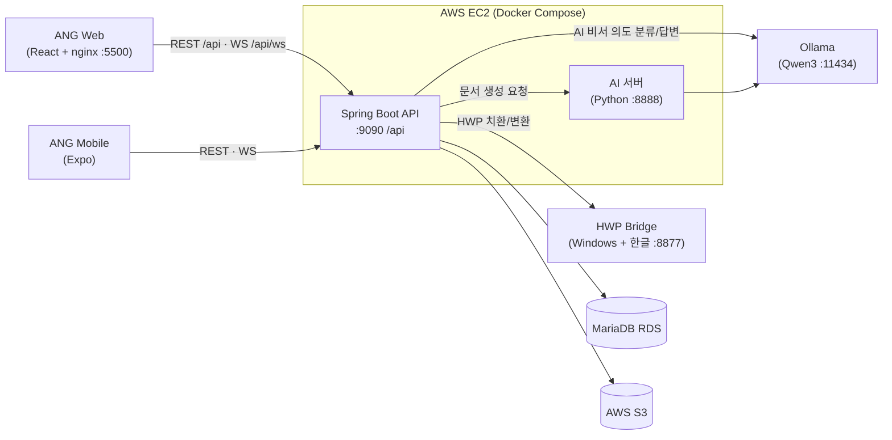

<div align="center">

# ANG (AI Network Group)

**조직 문서 관리 · 전자결재 · 실시간 협업 · AI 문서 작성을 하나로 묶은 사내 그룹웨어**

대학 행정 조직을 대상으로 만든 웹 포털과 Spring Boot 백엔드입니다.<br/>
조직 계층에 따른 문서 열람 권한과, AI로 문서를 만들고 고치는 기능이 핵심입니다.


</div>

<!-- 스크린샷: assets/screenshots/ 에 이미지를 넣고 경로를 바꿔주세요 -->
<!--
| 대시보드 | 문서 작성(AI) | 전자결재 | 채팅 |
|:---:|:---:|:---:|:---:|
|  |  |  |  |
-->

## 📌 프로젝트 소개

| 항목 | 내용 |
|---|---|
| 종류 | 2026 영진전문대학교 캡스톤 디자인 (팀 프로젝트) |
| 기간 | 2026.05 ~ 진행 중 |
| 목표 | 흩어져 있던 문서·결재·메신저·일정 업무를 한곳에서 처리하고, 반복적인 문서 작성을 AI로 줄이기 |
| 구성 | Web Frontend(React) · Backend(Spring Boot) · AI 서버(Python) · HWP Bridge(Windows) |

ANG는 대학 행정 조직을 위한 그룹웨어입니다. 문서 관리, 실시간 채팅, 전자결재, 메일, 일정을 한 화면에서 쓸 수 있습니다.
같은 백엔드를 [ANG Mobile](https://github.com/sunghyeon0073/ANG-APP) 앱도 함께 사용합니다.

## ✨ 주요 기능

| 기능 | 설명 |
|---|---|
| 🏠 **대시보드** | 결재 대기, 일정, 공지, 받은 메일, 알림을 한 화면에 요약 |
| 📝 **AI 문서 작성** | 메모나 요청을 입력하면 DOCX · XLSX · HWP 문서를 생성하고, 기존 양식의 빈칸도 채워줌 |
| 📁 **문서 / 파일 저장소** | 업로드·다운로드·미리보기(PDF, 이미지, Word, Excel, HWP), 즐겨찾기, 휴지통, 공유 |
| ✅ **전자결재** | 양식 선택 → 결재선 지정 → 승인/반려, 서명, 댓글, 완료 문서 PDF 자동 생성 |
| 💬 **실시간 채팅** | STOMP WebSocket 기반 1:1·그룹 채팅, 파일 전송 |
| 🔔 **실시간 알림** | 결재, 메일, 채팅 이벤트를 개인 큐로 즉시 전달 |
| 🤖 **AI 비서 (마스코트)** | "이번 주 일정 알려줘", "결재 대기 있어?" 같은 질문에 일정·메일·문서·결재를 찾아서 답변하고, 메일·메시지 예약 발송도 처리 |
| ✉️ **메일** | 내부 메일 발신·수신·임시저장·중요 표시, 첨부파일 |
| 📅 **일정** | 개인·부서 일정 캘린더 |
| 🏢 **조직 / 관리자** | 3단계 조직도, 여러 부서 동시 소속, 가입 승인·거절, 권한 변경, 퇴사 처리(익명화) |

## 🛠 기술 스택

| 분류 | 기술 |
|---|---|
| Backend | Spring Boot 3.4, Java 21, Spring Security 6, Spring Data JPA, Spring WebSocket (STOMP) |
| Frontend | React 19, Vite, React Router 7, Axios, @stomp/stompjs + SockJS |
| AI | Python (FastAPI), Ollama + Qwen3 (문서 생성: qwen3:14b `ang-ai` / AI 비서: qwen3:8b `ang-secretary`) |
| 문서 처리 | Apache POI (DOCX/XLSX), 한컴오피스 COM 자동화 (HWP Bridge) |
| 인증 | JWT (Access 30분 / Refresh 7일), STOMP CONNECT 토큰 검증 |
| Database / Storage | MariaDB (AWS RDS), AWS S3 |
| Infra | Docker Compose, nginx, AWS EC2, GitHub Actions (CI/CD) |

## 🏗 아키텍처



- 프론트엔드 nginx가 `/api`와 `/api/ws` 요청을 백엔드로 프록시합니다. 백엔드의 context-path(`/api`)와 경로를 맞췄습니다.
- HWP 파일은 리눅스 컨테이너에서 다룰 수 없습니다. 그래서 한컴오피스가 설치된 Windows에서 따로 브리지 서버를 띄워 처리합니다.

## 🔥 기술적 고민과 해결

### 1. 같은 조직 안에서만 문서를 볼 수 있게 하는 권한 구조
- **문제:** 조직은 `회사(L1) → 부서(L2) → 팀(L3)` 3단계입니다. 다른 팀이라도 같은 부서 소속이면 서로 문서를 볼 수 있어야 했습니다. 팀 단위로만 권한을 주면 범위가 너무 좁고, 회사 단위로 주면 너무 넓었습니다.
- **해결:** 사용자와 문서가 속한 조직에서 각각 **L2 조상 부서**를 찾고, 두 부서가 같으면 열람을 허용했습니다. 한 사용자가 여러 부서에 속할 수 있도록 `UserMembership`으로 소속을 관리하고, 부서마다 다른 직급을 가질 수 있게 했습니다.
- 📄 `domain/document/service/DocumentService.java`, `domain/scope/` → `getLevel2Ancestor()`

### 2. AI가 만든 문서가 원본 양식을 깨뜨리는 문제
- **문제:** LLM에게 문서 전체를 다시 쓰게 하면 표, 서식, 양식 구조가 무너졌습니다. 템플릿에 `{{변수}}` 같은 자리표시자도 따로 없었습니다.
- **해결:** AI는 **최소한의 find/replace 목록(JSON)** 만 돌려주게 하고, 실제 치환은 서버가 합니다. DOCX·XLSX는 Apache POI로 단락과 표 셀을 직접 고치고, HWP는 HWP Bridge(한컴 COM 자동화)에 치환 목록을 넘깁니다. 구어체 메모를 개조식으로 다듬는 규칙, 변수명이 정확히 같지 않아도 뜻이 맞는 칸에 채우는 규칙은 프롬프트(`AI/Modelfile`)에 정리했습니다.
- 📄 `domain/document/service/DocumentService.java`, `AI/main.py`, `HwpBridge/main.py`

### 3. 배포된 AI가 소스 코드와 다르게 동작하는 문제 → CD에서 Ollama 모델 자동 재생성
- **문제:** 프롬프트와 파라미터를 Modelfile로 관리하는데, Modelfile을 고쳐도 서버의 Ollama 모델은 다시 만들기 전까지 예전 그대로였습니다. 그래서 배포된 AI가 소스와 다르게 동작했습니다.
- **해결:** CD 배포 스크립트에 `ollama create` 단계를 넣어, 배포할 때마다 Modelfile로 `ang-ai`(qwen3:14b)와 `ang-secretary`(qwen3:8b) 모델을 다시 만들게 했습니다. 작업 성격에 맞춰 문서 생성은 14b, 빠른 의도 분류는 8b 모델을 씁니다.
- 📄 `AI/Modelfile`, `AI/Modelfile_secretary`, `.github/workflows/cd.yml`

### 4. AI 응답 시간과 프론트 타임아웃이 서로 맞지 않는 문제
- **문제:** 프론트 타임아웃(30초)이 백엔드의 AI 호출 대기 시간(180초)보다 짧았습니다. 그래서 백엔드가 문서를 정상적으로 만드는 중인데도 프론트가 먼저 포기했습니다. 반대로 AI 응답이 너무 빨라서 4단계 진행 연출이 끝나기도 전에 결과가 뜨는 일도 있었습니다.
- **해결:** 프론트 타임아웃을 **백엔드보다 조금 짧은 170초**로 맞추고, 로딩 화면은 **최소 5초** 보여주게 했습니다. AI 서버가 응답하지 않으면 데모용 문서로 대신 보여줘서 화면이 비지 않게 했습니다.
- 📄 `Frontend/src/contexts/AiGenerationContext.jsx`, `Frontend/src/utils/aiMockGenerator.js`

### 5. AI 비서의 느린 응답과 엉뚱한 의도 분류
- **문제:** 모든 질문을 LLM으로 분류하면 느렸고, 가끔 JSON 형식이 깨지거나 의도를 잘못 판단했습니다.
- **해결:** **키워드 분류 → LLM 분류 → 결과 정규화** 순서로 단계를 나눴습니다. "보내줘"처럼 의도가 분명한 요청은 LLM을 거치지 않고 바로 처리합니다. LLM이 실패하면 키워드 결과를 씁니다. 실제 DB 조회 결과를 LLM에 근거로 넘겨서, 없는 일정이나 메일을 지어내지 못하게 했습니다.
- 📄 `domain/aiassistant/service/AiAssistantAskService.java` → `classify()`, `enrichAnswerWithLLM()`

### 6. WebSocket 인증과 프록시 경로
- **문제:** HTTP 요청은 `JwtAuthenticationFilter`로 인증되지만, STOMP 메시지에는 사용자 정보가 없었습니다. 그래서 개인 알림 큐나 채팅 메시지의 발신자를 알 수 없었습니다. 또 `/ws`만 `/api` 접두사 없이 따로 프록시되고 있어서 nginx 설정이 일관되지 않았습니다.
- **해결:** `ChannelInterceptor`가 STOMP `CONNECT` 프레임의 `Authorization` 헤더를 검증해 세션에 사용자를 저장합니다. 토큰이 유효하지 않으면 연결을 거부합니다. 프록시 경로는 `/api/ws/`로 통일했습니다.
- 📄 `config/StompAuthInterceptor.java`, `config/WebSocketConfig.java`, `Frontend/nginx.conf`

### 7. 재배포하면 업로드 파일이 사라지는 문제
- **문제:** CD가 `docker compose down/up --build`를 할 때마다 컨테이너 안의 `uploads` 디렉터리가 함께 지워졌습니다. DB에는 파일 레코드가 남아 있는데 실제 파일이 없어서 다운로드가 404로 실패했습니다.
- **해결:** `ang-uploads` named volume을 `/app/uploads`에 연결해 재배포해도 파일이 남게 했습니다. 공유 파일과 결재 문서는 S3에 저장합니다.
- 📄 `docker-compose.yml`

### 8. 결재 완료 후 PDF 생성이 응답을 늦추는 문제
- **해결:** 마지막 승인 시 `ApprovalCompletedEvent`를 발행하고, **트랜잭션 커밋이 끝난 뒤 비동기로** PDF를 만들어 S3에 올립니다(`@TransactionalEventListener(AFTER_COMMIT)` + `@Async`). 승인 API는 바로 응답하고, 롤백된 결재로 PDF가 만들어지는 일도 없습니다. 보관 기간이 지난 문서는 매일 새벽 스케줄러가 정리합니다.
- 📄 `domain/approval/service/ApprovalPdfService.java`, `ApprovalRetentionScheduler.java`

## 📂 폴더 구조

```
ANG-Capstone/
├── Backend/                     # Spring Boot (:9090, context-path /api)
│   └── src/main/java/com/ang/Backend/
│       ├── config/              # Security, WebSocket/STOMP 인증, S3, Ollama, 초기 데이터
│       ├── security/            # JWT 필터 · 토큰 Provider
│       ├── common/              # 공통 enum, 예외, 응답 형식
│       └── domain/
│           ├── auth/ user/ role/ scope/   # 인증, 사용자, 권한, 조직도
│           ├── document/ file/            # 문서·AI 생성, S3 파일 저장소
│           ├── approval/                  # 전자결재 (결재선, 서명, PDF, 보관)
│           ├── chat/ notification/        # 실시간 채팅, 알림
│           ├── mail/ schedule/ board/ memo/
│           └── aiassistant/               # AI 비서, 예약 발송
├── Frontend/                    # React + Vite (nginx :5500)
│   └── src/
│       ├── api/                 # 도메인별 API, axios 인터셉터(토큰 자동 갱신)
│       ├── components/          # pages · common · chat · esignature · file · mail ...
│       ├── contexts/            # AI 문서 생성 상태
│       ├── router/  hooks/  utils/  style/
├── AI/                          # Python AI 서버 (:8888), Ollama 호출 · 프롬프트(Modelfile)
├── HwpBridge/                   # Windows 한컴오피스 COM 자동화 서버 (:8877)
├── docs/                        # 기능 정의서, API 명세서, ERD
├── scripts/                     # 로컬 개발 헬퍼 (HWP Bridge + Compose 동시 실행)
├── docker-compose.yml
└── .github/workflows/           # ci.yml · cd.yml
```

## 🚀 설치 매뉴얼

> 처음 프로젝트를 받아 **클론 → Docker 설정 → 백엔드 실행 → CI/CD 배포**까지 따라 할 수 있도록 정리했습니다.

| 순서 | 내용 |
|---|---|
| 1 | [사전 준비](#1-사전-준비) |
| 2 | [프로젝트 클론](#2-프로젝트-클론) |
| 3 | [Docker 설치와 설정](#3-docker-설치와-설정) |
| 4 | [백엔드 설치 및 실행](#4-백엔드-설치-및-실행) |
| 5 | [프론트엔드 · AI 서버 실행](#5-프론트엔드--ai-서버-실행) |
| 6 | [CI/CD 설정](#6-cicd-설정) |
| 7 | [문제 해결](#7-문제-해결) |

### 1. 사전 준비

| 도구 | 버전 | 용도 | 필수 |
|------|------|------|:----:|
| Git | 최신 | 클론 | ✅ |
| Docker Desktop / Docker Engine | 최신 | 전체 실행·배포 | ✅ |
| JDK | **21** | 백엔드를 직접 실행할 때 | 개발 시 |
| Node.js | **22** | 프론트를 직접 실행할 때 | 개발 시 |
| Python | **3.12** | AI 서버를 직접 실행할 때 | 개발 시 |
| Ollama | 최신 | AI 모델 실행 (Qwen3) | ✅ |
| AWS S3 버킷 + IAM 키 | — | 파일 업로드 | 선택 |

> Docker로만 실행할 거라면 **Git + Docker**만 있으면 됩니다. JDK·Node·Python은 컨테이너 안에서 설치됩니다.

---

### 2. 프로젝트 클론

```bash
git clone https://github.com/sunghyeon0073/ANG-Capstone.git
cd ANG-Capstone
```

개발 브랜치(`dev`)에서 작업하려면:

```bash
git checkout dev
```

클론이 잘 됐는지 확인 — 아래 폴더들이 보이면 성공입니다.

```
ANG-Capstone/
├── Backend/                 # Spring Boot
├── Frontend/                # React + Vite
├── AI/                      # FastAPI AI 서버
├── HwpBridge/               # (선택) 한글 문서 브릿지, Windows 전용
├── docker-compose.yml       # Backend + Frontend + AI
├── docker-compose.local.yml # 로컬용 MariaDB 추가
└── .github/workflows/       # ci.yml, cd.yml
```

---

### 3. Docker 설치와 설정

#### 3-1. Docker 설치

**Windows**

1. [Docker Desktop](https://www.docker.com/products/docker-desktop/) 다운로드 후 설치
2. 설치 중 **Use WSL 2 instead of Hyper-V** 체크 (기본값)
3. 재부팅 후 Docker Desktop 실행 → 좌측 하단이 초록색(**Engine running**)이 될 때까지 대기
4. WSL 업데이트 요구 시 PowerShell(관리자)에서 `wsl --update`

**macOS**

1. [Docker Desktop](https://www.docker.com/products/docker-desktop/)에서 본인 칩에 맞는 버전 설치 (Apple Silicon / Intel)
2. 응용 프로그램에서 Docker 실행 → 상단 메뉴바 고래 아이콘이 멈추면 준비 완료

**Ubuntu (AWS EC2 서버 포함)**

```bash
# Docker 공식 설치 스크립트
curl -fsSL https://get.docker.com | sudo sh

# sudo 없이 docker 쓰기
sudo usermod -aG docker $USER
newgrp docker

# 부팅 시 자동 실행
sudo systemctl enable --now docker
```

**설치 확인 (공통)**

```bash
docker --version
docker compose version
docker run --rm hello-world   # "Hello from Docker!" 가 나오면 성공
```

#### 3-2. 환경 변수 파일(`.env`) 만들기

프로젝트 **루트**(`docker-compose.yml`과 같은 위치)에 `.env` 파일을 만듭니다.

```env
# ── DB ──
# 로컬 MariaDB 컨테이너를 쓸 때(docker-compose.local.yml)
DB_URL=jdbc:mariadb://db:3306/ang
DB_USERNAME=ang
DB_PASSWORD=ang_local_password
MARIADB_ROOT_PASSWORD=ang_root_password
# AWS RDS를 쓸 때는 위 DB_URL을 아래처럼 바꿈
# DB_URL=jdbc:mariadb://<RDS-엔드포인트>:3306/ang_db

# ── 인증 ──
JWT_SECRET=32자-이상의-랜덤-문자열을-넣으세요-abcdefghijklmnop
ADMIN_INIT_PASSWORD=qwer1234!

# ── AI ──
AI_BASE_URL=http://ai:8888
OLLAMA_BASE_URL=http://host.docker.internal:11434
OLLAMA_MODEL=ang-ai:latest
OLLAMA_SECRETARY_MODEL=ang-secretary:latest

# ── AWS S3 ──
AWS_ACCESS_KEY_ID=dummy
AWS_SECRET_ACCESS_KEY=dummy
AWS_REGION=ap-northeast-3
S3_BUCKET=본인-버킷-이름
```

| 변수 | 설명 |
|------|------|
| `DB_URL` / `DB_USERNAME` / `DB_PASSWORD` | 백엔드가 접속할 DB. **비어 있으면 컨테이너가 시작되지 않습니다** |
| `JWT_SECRET` | 로그인 토큰 서명 키. **32자 이상** 필수 |
| `ADMIN_INIT_PASSWORD` | 초기 관리자 비밀번호 |
| `AI_BASE_URL` | 백엔드 → AI 서버 주소. Docker 안에서는 `http://ai:8888` |
| `OLLAMA_BASE_URL` | Ollama 서버 주소. Docker 컨테이너에서 호스트의 Ollama에 접속할 때는 `http://host.docker.internal:11434` |
| `OLLAMA_MODEL` / `OLLAMA_SECRETARY_MODEL` | 문서 생성 / AI 비서 모델 이름 ([Ollama 설치](#3-5-ollama-설치와-qwen-모델-준비) 참고) |
| `AWS_*`, `S3_BUCKET` | 파일 업로드용. 없으면 `dummy`로 두면 서버는 뜨고 업로드만 실패 |

> `.env`는 `.gitignore`에 등록되어 있습니다. **절대 커밋하지 마세요.**

#### 3-3. Docker로 실행

```bash
# 로컬 개발: MariaDB 컨테이너까지 함께 실행
docker compose -f docker-compose.yml -f docker-compose.local.yml up -d --build

# 서버(EC2): 외부 DB(RDS)를 쓰므로 기본 파일만
docker compose up -d --build
```

첫 빌드는 Gradle·npm·LibreOffice 설치 때문에 **5~10분** 걸립니다.

| 컨테이너 | 이름 | 주소 |
|----------|------|------|
| Frontend | `ang-frontend` | http://localhost:5500 |
| Backend | `ang-backend` | http://localhost:9090/api/health |
| AI | `ang-ai` | http://localhost:8888/health |
| DB (local만) | `ang-db` | localhost:3306 |

첫 실행 시 테이블과 테스트 계정이 자동 생성됩니다.

| 계정 | ID | 비밀번호 |
|------|----|----------|
| 최고관리자 | `admin` | `qwer1234!` |
| 원장 (김기종) | `manager` | `qwer1234!` |

#### 3-4. 자주 쓰는 Docker 명령

```bash
docker compose ps                     # 컨테이너 상태 확인
docker compose logs -f backend        # 백엔드 로그 실시간 보기
docker compose restart backend        # 백엔드만 재시작
docker compose up -d --build backend  # 백엔드만 다시 빌드
docker compose down                   # 전체 종료
docker compose -f docker-compose.yml -f docker-compose.local.yml down -v   # DB 데이터까지 삭제
docker image prune -f                 # 안 쓰는 이미지 정리
```

---

#### 3-5. Ollama 설치와 Qwen 모델 준비

AI 기능(문서 생성, AI 비서)은 **Ollama**로 **Qwen3** 모델을 돌립니다. Ollama는 Docker 컨테이너가 아니라 **호스트(PC 또는 EC2)에 직접 설치**합니다.

**설치**

| OS | 설치 방법 |
|----|-----------|
| Windows / macOS | [ollama.com/download](https://ollama.com/download)에서 설치 파일 실행 |
| Ubuntu (EC2) | `curl -fsSL https://ollama.com/install.sh \| sh` |

```bash
ollama --version
ollama serve        # 백그라운드 실행 중이 아니라면 (기본 포트 11434)
```

**Qwen 모델 받기 + 프로젝트 모델 만들기** (프로젝트 루트에서)

```bash
ollama pull qwen3:14b
ollama pull qwen3:8b

ollama create ang-ai -f AI/Modelfile                   # 문서 생성용 (qwen3:14b 기반)
ollama create ang-secretary -f AI/Modelfile_secretary  # AI 비서용 (qwen3:8b 기반)

ollama list         # ang-ai, ang-secretary 가 보이면 완료
```

> - `AI/Modelfile`을 수정했다면 `ollama create`를 다시 실행해야 반영됩니다.
> - qwen3:14b는 약 9GB입니다. 메모리(또는 GPU VRAM)가 부족하면 응답이 매우 느려질 수 있습니다.

### 4. 백엔드 설치 및 실행

Docker 없이 백엔드를 직접 띄워 개발할 때의 방법입니다.

#### 4-1. JDK 21 설치

| OS | 설치 방법 |
|----|-----------|
| Windows | [Eclipse Temurin 21](https://adoptium.net/temurin/releases/?version=21) `.msi` 설치 → 설치 화면에서 **Set JAVA_HOME** 체크 |
| macOS | `brew install --cask temurin@21` |
| Ubuntu | `sudo apt update && sudo apt install -y openjdk-21-jdk` |

```bash
java -version   # openjdk version "21..." 이 나오면 성공
```

> Gradle은 따로 설치하지 않습니다. 프로젝트에 포함된 `gradlew`가 자동으로 받아옵니다.

#### 4-2. DB 준비

MariaDB를 설치하지 않았다면 DB만 Docker로 띄웁니다.

```bash
docker run -d --name ang-db -p 3306:3306 \
  -e MARIADB_DATABASE=ang \
  -e MARIADB_USER=ang \
  -e MARIADB_PASSWORD=ang_local_password \
  -e MARIADB_ROOT_PASSWORD=ang_root_password \
  mariadb:11.4
```

테이블은 백엔드 첫 실행 시 JPA(`ddl-auto: update`)가 자동 생성합니다.

#### 4-3. 환경 변수 설정 후 실행

백엔드 설정(`Backend/src/main/resources/application.yml`)은 값을 **환경 변수**에서 읽습니다.

**Windows (PowerShell)**

```powershell
cd Backend
$env:DB_URL="jdbc:mariadb://localhost:3306/ang"
$env:DB_USERNAME="ang"
$env:DB_PASSWORD="ang_local_password"
$env:JWT_SECRET="32자-이상의-랜덤-문자열을-넣으세요-abcdefghijklmnop"
$env:ADMIN_INIT_PASSWORD="qwer1234!"
$env:OLLAMA_BASE_URL="http://localhost:11434"
$env:AWS_ACCESS_KEY_ID="dummy"
$env:AWS_SECRET_ACCESS_KEY="dummy"
.\gradlew.bat bootRun
```

**macOS / Linux**

```bash
cd Backend
export DB_URL="jdbc:mariadb://localhost:3306/ang"
export DB_USERNAME=ang
export DB_PASSWORD=ang_local_password
export JWT_SECRET="32자-이상의-랜덤-문자열을-넣으세요-abcdefghijklmnop"
export ADMIN_INIT_PASSWORD="qwer1234!"
export OLLAMA_BASE_URL=http://localhost:11434
export AWS_ACCESS_KEY_ID=dummy
export AWS_SECRET_ACCESS_KEY=dummy
chmod +x gradlew
./gradlew bootRun
```

로그에 `Started SpringBootDeveloperApplication`이 보이면 http://localhost:9090/api/health 로 확인합니다.

#### 4-4. IntelliJ에서 실행

1. **File → Open** → `ANG-Capstone/Backend` 폴더 선택 (Gradle 프로젝트로 열림)
2. **File → Project Structure → SDK**를 **21**로 지정
3. `SpringBootDeveloperApplication` 실행 구성 → **Modify options → Environment variables**에 4-3의 값을 `KEY=VALUE;KEY=VALUE` 형식으로 입력
4. ▶ 실행

> 환경 변수 대신 `application-local.yml.example`을 복사해 `application-local.yml`로 만들고 `${...}` 자리에 실제 값을 넣어도 됩니다. (Git에 올라가지 않음)

#### 4-5. JAR로 빌드

```bash
cd Backend
./gradlew bootJar            # Windows: .\gradlew.bat bootJar
java -jar build/libs/*.jar   # 환경 변수가 설정된 터미널에서 실행
```

---

### 5. 프론트엔드 · AI 서버 실행

**Frontend** (Node.js 22)

```bash
cd Frontend
npm install
npm run dev        # http://localhost:5500 자동 열림
```

`/api` 요청(WebSocket 포함)은 Vite 프록시가 `http://127.0.0.1:9090`으로 넘겨줍니다.

**AI 서버** (Python 3.12)

```bash
cd AI
python -m venv .venv
source .venv/bin/activate          # Windows: .\.venv\Scripts\Activate.ps1
pip install -r requirements.txt
cp .env.example .env               # Windows: copy .env.example .env  → OLLAMA 값 확인
uvicorn main:app --reload --port 8888 --env-file .env
```

---

### 6. CI/CD 설정

GitHub Actions로 **CI(빌드 검증)**와 **CD(EC2 자동 배포)**를 합니다.

```
개발자 push / PR
      │
      ▼
┌──────────────┐  main · dev · dev-server · test-server
│  CI (ci.yml) │  Backend / Frontend / AI 빌드 + Dockerfile 빌드 검증
└──────┬───────┘
       │ dev 또는 dev-server 에 push 되면
       ▼
┌──────────────┐  GitHub → EC2 SSH 접속
│  CD (cd.yml) │  git reset --hard → ollama create → docker compose up -d --build
└──────────────┘
```

#### 6-1. CI — `.github/workflows/ci.yml`

| 항목 | 내용 |
|------|------|
| 실행 조건 | `main`, `dev`, `dev-server`, `test-server`에 **push 또는 PR** |
| backend | JDK 21 → `./gradlew bootJar` → `Backend/Dockerfile` 빌드 확인 |
| frontend | Node 22 → `npm install && npm run build` → `Frontend/Dockerfile` 빌드 확인 |
| ai | Python 3.12 → `pip install -r requirements.txt` → `AI/Dockerfile` 빌드 확인 |

별도 설정은 필요 없습니다. PR 화면의 **Checks**에서 결과를 확인하고, ❌가 뜨면 **Details**에서 로그를 확인합니다.

#### 6-2. CD — `.github/workflows/cd.yml`

`dev` 또는 `dev-server` 브랜치에 push(= PR merge)되면 EC2에 SSH로 접속해 아래를 실행합니다.

```bash
cd $DEPLOY_PATH
git fetch origin
git checkout <브랜치>
git reset --hard origin/<브랜치>
ollama create ang-ai -f AI/Modelfile                   # Modelfile 변경 반영
ollama create ang-secretary -f AI/Modelfile_secretary
docker compose down
docker compose up -d --build
docker image prune -f
```

##### ① EC2 서버 준비 (최초 1회)

1. **EC2 인스턴스 생성** — Ubuntu 22.04/24.04, 메모리 4GB 이상 권장 (빌드 시 Gradle·npm·LibreOffice 사용)
2. **보안 그룹 인바운드 규칙**

   | 포트 | 용도 |
   |------|------|
   | 22 | SSH (GitHub Actions 접속) |
   | 5500 | 웹 화면 |
   | 9090 | 백엔드 API (필요 시) |

   > 11434(Ollama) 포트는 외부에 열지 않습니다. 서버 내부에서만 사용합니다.

3. **Docker 설치** — [3-1 Ubuntu](#3-1-docker-설치) 명령 실행. 이어서 **Ollama 설치 + Qwen 모델 생성** — [3-5](#3-5-ollama-설치와-qwen-모델-준비) 명령 실행
4. **프로젝트 클론**

   ```bash
   cd ~
   git clone https://github.com/sunghyeon0073/ANG-Capstone.git
   cd ANG-Capstone
   pwd    # 이 경로가 DEPLOY_PATH (예: /home/ubuntu/ANG-Capstone)
   ```

5. **`.env` 작성** — [3-2](#3-2-환경-변수-파일env-만들기) 참고. 서버에서는 `DB_URL`을 RDS 주소로 지정
6. **수동으로 한 번 실행해 보기**

   ```bash
   docker compose up -d --build
   docker compose ps
   ```

##### ② SSH 키 준비

GitHub Actions가 EC2에 접속할 때 쓸 키입니다. EC2 생성 시 받은 `.pem` 키를 그대로 써도 되고, 배포 전용 키를 새로 만들어도 됩니다.

```bash
# (배포 전용 키를 만들 경우) EC2 서버에서
ssh-keygen -t ed25519 -f ~/.ssh/ang_deploy -N ""
cat ~/.ssh/ang_deploy.pub >> ~/.ssh/authorized_keys
cat ~/.ssh/ang_deploy        # 출력된 개인키 전체를 복사 → DEPLOY_KEY 에 등록
```

##### ③ GitHub Secrets 등록

저장소 **Settings → Secrets and variables → Actions → New repository secret**

| Secret 이름 | 값 예시 |
|-------------|---------|
| `DEPLOY_HOST` | EC2 퍼블릭 IP 또는 도메인 (예: `15.168.xxx.xxx`) |
| `DEPLOY_USER` | `ubuntu` |
| `DEPLOY_KEY` | 개인키 전체 (`-----BEGIN ... KEY-----`부터 `-----END ... KEY-----`까지) |
| `DEPLOY_PATH` | `/home/ubuntu/ANG-Capstone` |

##### ④ 배포 확인

1. `dev` 브랜치로 PR을 merge
2. 저장소 **Actions** 탭 → **CD Deploy** 워크플로 클릭
3. 로그에 `===== DEPLOY COMPLETE =====`가 보이면 성공
4. `http://<EC2-IP>:5500` 접속해 확인

> ⚠️ CD는 서버에서 `git reset --hard`를 실행합니다. **EC2에서 직접 수정한 코드는 배포 때 사라집니다.** (`.env`는 Git 추적 대상이 아니라 유지됩니다)

---

### 7. 문제 해결

| 증상 | 원인 / 해결 |
|------|-------------|
| `DB_URL is required` | 루트에 `.env`가 없거나 값이 비어 있음 |
| `Cannot connect to the Docker daemon` | Docker Desktop이 꺼져 있음 / Ubuntu는 `sudo systemctl start docker` |
| `permission denied ... docker.sock` | `sudo usermod -aG docker $USER` 후 재접속 |
| 백엔드 `Communications link failure` | DB가 안 떴거나 주소가 틀림 → `docker compose ps`로 DB 확인 |
| `WeakKeyException` (JWT) | `JWT_SECRET`이 32자 미만 |
| `./gradlew: Permission denied` | `chmod +x gradlew` |
| `Port 5500 is already in use` | VS Code Live Server 등 다른 프로그램 종료 |
| EC2 빌드 중 멈춤 / 컨테이너 종료 | 메모리 부족 → 인스턴스 크기 상향 또는 스왑 추가 |
| CD `ssh: handshake failed` | `DEPLOY_KEY` 줄바꿈 누락, `DEPLOY_USER` 오타, 보안 그룹 22번 포트 확인 |
| CD `cd: ... No such file or directory` | `DEPLOY_PATH`가 EC2의 실제 클론 경로와 다름 |
| AI 기능 500 에러 | `ollama list`로 `ang-ai`, `ang-secretary` 모델 확인, `ollama serve` 실행 여부 확인 |
| `model "ang-ai" not found` | `ollama create ang-ai -f AI/Modelfile` 실행 |

## 📚 문서

- [API 기능 명세서](docs/API_기능_명세서.md)
- [ERD 구조 정의서](docs/ERD_구조_정의서.md)
- [최종 기능 정의서](docs/최종_기능_정의서.md)

## 🔗 관련 레포

- [ANG-APP](https://github.com/sunghyeon0073/ANG-APP): 같은 백엔드를 쓰는 모바일 앱 (Expo / React Native)
