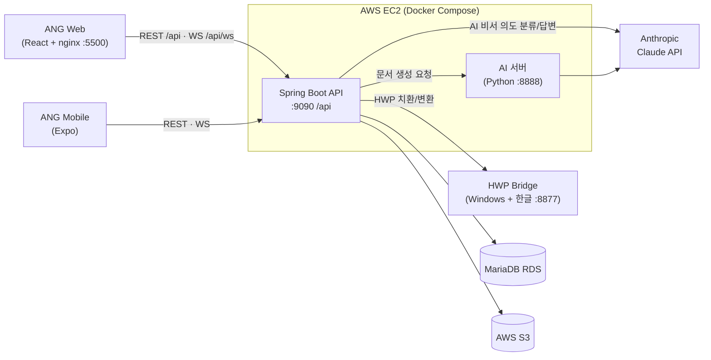

<div align="center">

# ANG (AI Network Group)

**조직 문서 관리 · 전자결재 · 실시간 협업 · AI 문서 작성을 하나로 묶은 사내 그룹웨어**

대학 행정 조직을 대상으로 만든 웹 포털과 Spring Boot 백엔드입니다.<br/>
조직 계층에 따른 문서 열람 권한과, AI로 문서를 만들고 고치는 기능이 핵심입니다.


</div>

<!-- 스크린샷: assets/screenshots/ 에 이미지를 넣고 경로를 바꿔주세요 -->
<!--
| 대시보드 | 문서 작성(AI) | 전자결재 | 채팅 |
|:---:|:---:|:---:|:---:|
|  |  |  |  |
-->

## 📌 프로젝트 소개

| 항목 | 내용 |
|---|---|
| 종류 | 2026 영진전문대학교 캡스톤 디자인 (팀 프로젝트) |
| 기간 | 2026.05 ~ 진행 중 |
| 목표 | 흩어져 있던 문서·결재·메신저·일정 업무를 한곳에서 처리하고, 반복적인 문서 작성을 AI로 줄이기 |
| 구성 | Web Frontend(React) · Backend(Spring Boot) · AI 서버(Python) · HWP Bridge(Windows) |

ANG는 대학 행정 조직을 위한 그룹웨어입니다. 문서 관리, 실시간 채팅, 전자결재, 메일, 일정을 한 화면에서 쓸 수 있습니다.
같은 백엔드를 [ANG Mobile](https://github.com/sunghyeon0073/ANG-APP) 앱도 함께 사용합니다.

## ✨ 주요 기능

| 기능 | 설명 |
|---|---|
| 🏠 **대시보드** | 결재 대기, 일정, 공지, 받은 메일, 알림을 한 화면에 요약 |
| 📝 **AI 문서 작성** | 메모나 요청을 입력하면 DOCX · XLSX · HWP 문서를 생성하고, 기존 양식의 빈칸도 채워줌 |
| 📁 **문서 / 파일 저장소** | 업로드·다운로드·미리보기(PDF, 이미지, Word, Excel, HWP), 즐겨찾기, 휴지통, 공유 |
| ✅ **전자결재** | 양식 선택 → 결재선 지정 → 승인/반려, 서명, 댓글, 완료 문서 PDF 자동 생성 |
| 💬 **실시간 채팅** | STOMP WebSocket 기반 1:1·그룹 채팅, 파일 전송 |
| 🔔 **실시간 알림** | 결재, 메일, 채팅 이벤트를 개인 큐로 즉시 전달 |
| 🤖 **AI 비서 (마스코트)** | "이번 주 일정 알려줘", "결재 대기 있어?" 같은 질문에 일정·메일·문서·결재를 찾아서 답변하고, 메일·메시지 예약 발송도 처리 |
| ✉️ **메일** | 내부 메일 발신·수신·임시저장·중요 표시, 첨부파일 |
| 📅 **일정** | 개인·부서 일정 캘린더 |
| 🏢 **조직 / 관리자** | 3단계 조직도, 여러 부서 동시 소속, 가입 승인·거절, 권한 변경, 퇴사 처리(익명화) |

## 🛠 기술 스택

| 분류 | 기술 |
|---|---|
| Backend | Spring Boot 3.4, Java 21, Spring Security 6, Spring Data JPA, Spring WebSocket (STOMP) |
| Frontend | React 19, Vite, React Router 7, Axios, @stomp/stompjs + SockJS |
| AI | Python (FastAPI), Anthropic Claude API (문서 생성: Sonnet / AI 비서: Haiku) |
| 문서 처리 | Apache POI (DOCX/XLSX), 한컴오피스 COM 자동화 (HWP Bridge) |
| 인증 | JWT (Access 30분 / Refresh 7일), STOMP CONNECT 토큰 검증 |
| Database / Storage | MariaDB (AWS RDS), AWS S3 |
| Infra | Docker Compose, nginx, AWS EC2, GitHub Actions (CI/CD) |

## 🏗 아키텍처



- 프론트엔드 nginx가 `/api`와 `/api/ws` 요청을 백엔드로 프록시합니다. 백엔드의 context-path(`/api`)와 경로를 맞췄습니다.
- HWP 파일은 리눅스 컨테이너에서 다룰 수 없습니다. 그래서 한컴오피스가 설치된 Windows에서 따로 브리지 서버를 띄워 처리합니다.

## 🔥 기술적 고민과 해결

### 1. 같은 조직 안에서만 문서를 볼 수 있게 하는 권한 구조
- **문제:** 조직은 `회사(L1) → 부서(L2) → 팀(L3)` 3단계입니다. 다른 팀이라도 같은 부서 소속이면 서로 문서를 볼 수 있어야 했습니다. 팀 단위로만 권한을 주면 범위가 너무 좁고, 회사 단위로 주면 너무 넓었습니다.
- **해결:** 사용자와 문서가 속한 조직에서 각각 **L2 조상 부서**를 찾고, 두 부서가 같으면 열람을 허용했습니다. 한 사용자가 여러 부서에 속할 수 있도록 `UserMembership`으로 소속을 관리하고, 부서마다 다른 직급을 가질 수 있게 했습니다.
- 📄 `domain/document/service/DocumentService.java`, `domain/scope/` → `getLevel2Ancestor()`

### 2. AI가 만든 문서가 원본 양식을 깨뜨리는 문제
- **문제:** LLM에게 문서 전체를 다시 쓰게 하면 표, 서식, 양식 구조가 무너졌습니다. 템플릿에 `{{변수}}` 같은 자리표시자도 따로 없었습니다.
- **해결:** AI는 **최소한의 find/replace 목록(JSON)** 만 돌려주게 하고, 실제 치환은 서버가 합니다. DOCX·XLSX는 Apache POI로 단락과 표 셀을 직접 고치고, HWP는 HWP Bridge(한컴 COM 자동화)에 치환 목록을 넘깁니다. 구어체 메모를 개조식으로 다듬는 규칙, 변수명이 정확히 같지 않아도 뜻이 맞는 칸에 채우는 규칙은 프롬프트(`AI/Modelfile`)에 정리했습니다.
- 📄 `domain/document/service/DocumentService.java`, `AI/main.py`, `HwpBridge/main.py`

### 3. 배포된 AI가 소스 코드와 다르게 동작하는 문제 → Claude API로 전환
- **문제:** 처음에는 EC2에서 Ollama로 로컬 모델을 돌렸습니다. 그런데 Modelfile을 고칠 때마다 서버에서 모델을 다시 빌드해야 했습니다. 이 단계가 CD에서 빠지면서 배포된 AI가 소스와 다르게 동작했습니다.
- **해결:** 문서 생성(AI 서버)과 AI 비서(백엔드) 모두 **Anthropic Claude API**로 바꿨습니다. 프롬프트가 코드와 함께 배포되므로 모델을 다시 빌드할 필요가 없어졌습니다. 작업 성격에 맞춰 문서 생성은 Sonnet, 빠른 의도 분류는 Haiku를 씁니다.
- 📄 `config/AnthropicConfig.java`, `domain/aiassistant/service/AiAssistantAskService.java`, `AI/main.py`

### 4. AI 응답 시간과 프론트 타임아웃이 서로 맞지 않는 문제
- **문제:** 프론트 타임아웃(30초)이 백엔드의 AI 호출 대기 시간(180초)보다 짧았습니다. 그래서 백엔드가 문서를 정상적으로 만드는 중인데도 프론트가 먼저 포기했습니다. 반대로 Claude 응답이 너무 빨라서 4단계 진행 연출이 끝나기도 전에 결과가 뜨는 일도 있었습니다.
- **해결:** 프론트 타임아웃을 **백엔드보다 조금 짧은 170초**로 맞추고, 로딩 화면은 **최소 5초** 보여주게 했습니다. AI 서버가 응답하지 않으면 데모용 문서로 대신 보여줘서 화면이 비지 않게 했습니다.
- 📄 `Frontend/src/contexts/AiGenerationContext.jsx`, `Frontend/src/utils/aiMockGenerator.js`

### 5. AI 비서의 느린 응답과 엉뚱한 의도 분류
- **문제:** 모든 질문을 LLM으로 분류하면 느렸고, 가끔 JSON 형식이 깨지거나 의도를 잘못 판단했습니다.
- **해결:** **키워드 분류 → LLM 분류 → 결과 정규화** 순서로 단계를 나눴습니다. "보내줘"처럼 의도가 분명한 요청은 LLM을 거치지 않고 바로 처리합니다. LLM이 실패하면 키워드 결과를 씁니다. 실제 DB 조회 결과를 LLM에 근거로 넘겨서, 없는 일정이나 메일을 지어내지 못하게 했습니다.
- 📄 `domain/aiassistant/service/AiAssistantAskService.java` → `classify()`, `enrichAnswerWithLLM()`

### 6. WebSocket 인증과 프록시 경로
- **문제:** HTTP 요청은 `JwtAuthenticationFilter`로 인증되지만, STOMP 메시지에는 사용자 정보가 없었습니다. 그래서 개인 알림 큐나 채팅 메시지의 발신자를 알 수 없었습니다. 또 `/ws`만 `/api` 접두사 없이 따로 프록시되고 있어서 nginx 설정이 일관되지 않았습니다.
- **해결:** `ChannelInterceptor`가 STOMP `CONNECT` 프레임의 `Authorization` 헤더를 검증해 세션에 사용자를 저장합니다. 토큰이 유효하지 않으면 연결을 거부합니다. 프록시 경로는 `/api/ws/`로 통일했습니다.
- 📄 `config/StompAuthInterceptor.java`, `config/WebSocketConfig.java`, `Frontend/nginx.conf`

### 7. 재배포하면 업로드 파일이 사라지는 문제
- **문제:** CD가 `docker compose down/up --build`를 할 때마다 컨테이너 안의 `uploads` 디렉터리가 함께 지워졌습니다. DB에는 파일 레코드가 남아 있는데 실제 파일이 없어서 다운로드가 404로 실패했습니다.
- **해결:** `ang-uploads` named volume을 `/app/uploads`에 연결해 재배포해도 파일이 남게 했습니다. 공유 파일과 결재 문서는 S3에 저장합니다.
- 📄 `docker-compose.yml`

### 8. 결재 완료 후 PDF 생성이 응답을 늦추는 문제
- **해결:** 마지막 승인 시 `ApprovalCompletedEvent`를 발행하고, **트랜잭션 커밋이 끝난 뒤 비동기로** PDF를 만들어 S3에 올립니다(`@TransactionalEventListener(AFTER_COMMIT)` + `@Async`). 승인 API는 바로 응답하고, 롤백된 결재로 PDF가 만들어지는 일도 없습니다. 보관 기간이 지난 문서는 매일 새벽 스케줄러가 정리합니다.
- 📄 `domain/approval/service/ApprovalPdfService.java`, `ApprovalRetentionScheduler.java`

## 👤 담당 역할

<!-- 실제 역할에 맞게 수정해주세요 -->
- AI 문서 생성 흐름 설계: 프롬프트 규칙, find/replace 치환 방식, 타임아웃·폴백 처리
- Ollama → Anthropic Claude API 전환 (AI 서버, AI 비서)
- Docker Compose · GitHub Actions 기반 CI/CD, 업로드 볼륨 영속화, nginx 프록시 정리

## 📂 폴더 구조

```
ANG-Capstone/
├── Backend/                     # Spring Boot (:9090, context-path /api)
│   └── src/main/java/com/ang/Backend/
│       ├── config/              # Security, WebSocket/STOMP 인증, S3, Anthropic, 초기 데이터
│       ├── security/            # JWT 필터 · 토큰 Provider
│       ├── common/              # 공통 enum, 예외, 응답 형식
│       └── domain/
│           ├── auth/ user/ role/ scope/   # 인증, 사용자, 권한, 조직도
│           ├── document/ file/            # 문서·AI 생성, S3 파일 저장소
│           ├── approval/                  # 전자결재 (결재선, 서명, PDF, 보관)
│           ├── chat/ notification/        # 실시간 채팅, 알림
│           ├── mail/ schedule/ board/ memo/
│           └── aiassistant/               # AI 비서, 예약 발송
├── Frontend/                    # React + Vite (nginx :5500)
│   └── src/
│       ├── api/                 # 도메인별 API, axios 인터셉터(토큰 자동 갱신)
│       ├── components/          # pages · common · chat · esignature · file · mail ...
│       ├── contexts/            # AI 문서 생성 상태
│       ├── router/  hooks/  utils/  style/
├── AI/                          # Python AI 서버 (:8888), Claude API 호출 · 프롬프트(Modelfile)
├── HwpBridge/                   # Windows 한컴오피스 COM 자동화 서버 (:8877)
├── docs/                        # 기능 정의서, API 명세서, ERD
├── scripts/                     # 로컬 개발 헬퍼 (HWP Bridge + Compose 동시 실행)
├── docker-compose.yml
└── .github/workflows/           # ci.yml · cd.yml
```

## 🚀 실행 방법

### Docker Compose (권장)

프로젝트 루트에 `.env`를 만든 뒤 실행합니다.

```bash
docker compose up -d --build
```

| 서비스 | 주소 |
|---|---|
| Frontend | http://localhost:5500 |
| Backend API | http://localhost:9090/api |
| AI 서버 | http://localhost:8888 |

### 로컬 개발

```bash
# Backend
cd Backend && ./gradlew bootRun          # http://localhost:9090/api

# Frontend
cd Frontend && npm install && npm run dev   # http://localhost:5173 (/api → 9090 프록시)
```

HWP 기능까지 쓰려면 Windows에서 HWP Bridge를 함께 실행합니다([HwpBridge/README.md](HwpBridge/README.md)).

```powershell
.\scripts\dev-up-with-hwp.ps1
```

### 환경 변수 (`.env`)

```env
# Database (AWS RDS MariaDB)
DB_URL=jdbc:mariadb://<host>:3306/ang_db
DB_USERNAME=
DB_PASSWORD=

# JWT / 관리자
JWT_SECRET=
ADMIN_INIT_PASSWORD=

# CORS
CORS_ALLOWED_ORIGIN_PATTERNS=http://localhost:5500,http://localhost:5173

# AI
AI_BASE_URL=http://ai:8888
ANTHROPIC_API_KEY=
ANTHROPIC_MODEL=
HWP_EDIT_BASE_URL=http://<windows-host-ip>:8877

# AWS S3
AWS_ACCESS_KEY_ID=
AWS_SECRET_ACCESS_KEY=
AWS_REGION=
S3_BUCKET=
```

### 초기 계정

| 계정 | ID | 비밀번호 |
|---|---|---|
| 최고관리자 | `admin` | `qwer1234!` |
| 평생교육원 원장 | `manager` | `qwer1234!` |

> 운영 환경에서는 반드시 비밀번호를 변경하세요.

## ⚙️ CI/CD

- **CI (`ci.yml`)**: `main`, `dev`, `dev-server`, `test-server` 브랜치에 push 또는 PR이 올라오면 Backend · Frontend · AI 빌드를 검증합니다.
- **CD (`cd.yml`)**: `dev`, `dev-server` 브랜치에 push하면 EC2에 SSH로 접속해 `docker compose up -d --build`로 자동 배포합니다.

## 📚 문서

- [API 기능 명세서](docs/API_기능_명세서.md)
- [ERD 구조 정의서](docs/ERD_구조_정의서.md)
- [최종 기능 정의서](docs/최종_기능_정의서.md)

## 🔗 관련 레포

- [ANG-APP](https://github.com/sunghyeon0073/ANG-APP): 같은 백엔드를 쓰는 모바일 앱 (Expo / React Native)
